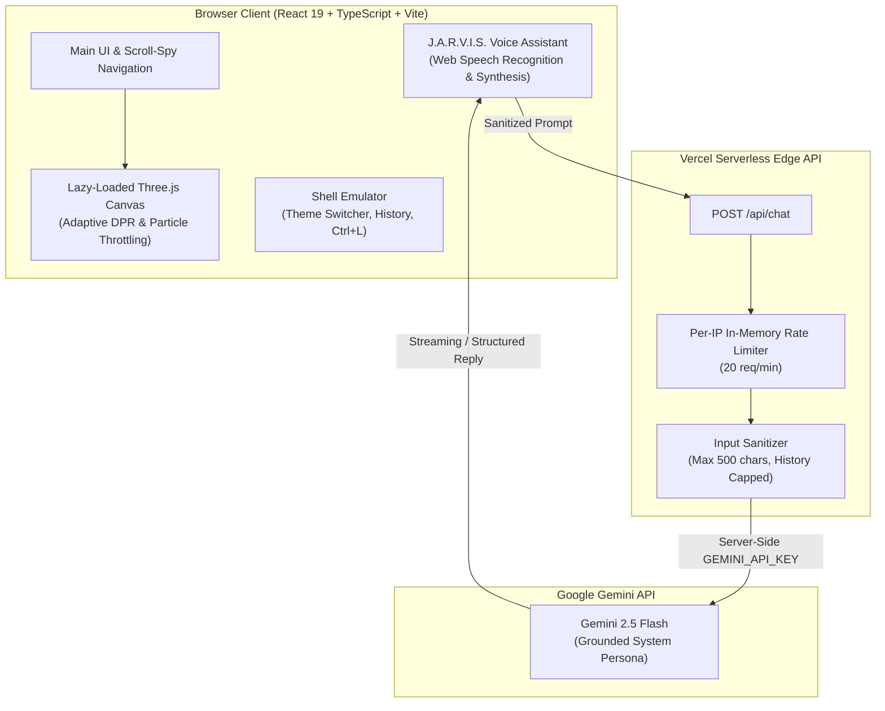

# Priyanraj J — High-Performance Engineering Portfolio & J.A.R.V.I.S. Mainframe

[](https://vitejs.dev/)
[](https://reactjs.org/)
[](https://www.typescriptlang.org/)
[](https://threejs.org/)
[](https://tailwindcss.com/)
[](https://vercel.com/)
[](LICENSE)

> *"AI and embedded-systems engineer building secure, intelligent systems."*

Next-generation, high-performance portfolio engineered for **Priyanraj J** (B.Tech CCE @ Amrita Vishwa Vidyapeetham • BS Data Science @ IIT Madras • BS DS&AI @ IIT Guwahati). Built with React 19, TypeScript, Three.js, and Tailwind CSS v4 under the **Arc Reactor Gold & Deep Obsidian** design system.

---

## 🏛️ System Architecture



---

## 🚀 Key Architectural Highlights

### 1. 🛡️ Zero Client-Side Secret Leakage (Security First)
- All Gemini LLM calls are routed exclusively through a serverless backend proxy (`/api/chat.ts`).
- The `GEMINI_API_KEY` exists purely server-side.
- In-memory per-IP rate limiting (20 req/min) prevents API abuse.
- Request validation caps user messages at 500 characters and keeps conversation context to the last 10 turns.

### 2. ⚡ Arc Reactor Gold Design System
- Unified token system defined in `src/index.css` with `@theme`:
  - Obsidian Core Background: `#07080d`
  - Deep Surface: `#10121a`
  - Arc Reactor Gold Accent: `#ffb703`
  - Forge Amber Secondary: `#ff6b35`
  - High-Contrast Text: `#f4f1ea` meeting WCAG AA (4.5:1+ contrast ratio).
- Custom typography pairing: **Space Grotesk** (Headings), **Inter** (Body), and **JetBrains Mono** (Code & Terminal).

### 3. 🌐 Three.js 3D Quantum Core with Adaptive Fallbacks
- Interactive 3D holographic core lazy-loaded via `React.lazy()` and `Suspense`.
- Dynamic particle budgeting based on device hardware concurrency and screen width.
- Automatic rendering freeze when canvas is scrolled off-screen or tab is hidden.
- Graceful CSS skeleton and static WebGL fallback for low-power or `prefers-reduced-motion` environments.
- Rollup `manualChunks` code-splitting keeps initial page bundle lightweight (~140 KB).

### 4. 🤖 J.A.R.V.I.S. AI Voice Assistant (Sōsuke Aizen Tuning)
- Custom persona combining classic J.A.R.V.I.S. precision with the calm, aristocratic cadence of anime character Sōsuke Aizen (tuned pitch: `0.82`, rate: `0.90`).
- Speech-to-text mic input via Web Speech API with toggleable speech synthesis output.
- Offline grounded dataset fallback ensuring instant responses even under network dropouts.
- Quick suggested prompt chips, message timestamps, and floating launcher trigger.

### 5. 💻 Interactive Shell Emulator (`priyanraj@mainframe`)
- Zsh-style shell featuring:
  - `theme`: Live toggles UI accent palette between **Gold**, **Violet**, and **Emerald**.
  - `resume`: Instantly opens verified PDF resume.
  - History traversal via `↑` and `↓` arrow keys.
  - Tab auto-completion across all commands.
  - `Ctrl+L` and clear button buffer flush.
  - Mobile tap-to-focus with 16px font-size to prevent unwanted mobile zoom.

### 6. 🎓 Multi-Institutional Academic foundation & 11 Licenses
- Clean 3-column timeline for concurrent tracks at **Amrita**, **IIT Madras**, and **IIT Guwahati**.
- Categorized technical competencies matrix with subtle proficiency tags (no arbitrary percentage bars).
- Verified credentials grid with live accreditation links (Google Cloud GenAI, Oracle SQL, NPTEL OS, IEEE CAS).
- Participation records across competitive national hackathons.

---

## 📁 Repository Structure

```
├── api/
│   └── chat.ts                 # Serverless Gemini proxy with rate-limiting
├── public/
│   ├── favicon.svg             # Arc Reactor Gold vector icon
│   ├── jarvis-core.png         # Fallback core visual
│   ├── og-image.png            # Open Graph social preview
│   ├── profile.webp            # Optimized developer avatar
│   ├── resume.pdf              # Verified CV asset
│   ├── robots.txt              # Search engine crawling rules
│   └── sitemap.xml             # Sitemap specification
├── src/
│   ├── components/
│   │   ├── AiVoiceAssistant.tsx        # Floating AI voice assistant
│   │   ├── BrandIcons.tsx              # Clean SVG icons
│   │   ├── CertificatesSection.tsx     # 11 licenses & hackathons
│   │   ├── CompetitiveProfiles.tsx     # LeetCode, Codeforces, AtCoder
│   │   ├── ContactSection.tsx          # Contact form & uplinks
│   │   ├── EducationSection.tsx        # Triple-track academic cards
│   │   ├── ExperienceSection.tsx       # IEEE Webmaster & internships
│   │   ├── Hero3DCanvas.tsx            # Optimized Three.js scene
│   │   ├── HeroSection.tsx             # Hero with typed headline
│   │   ├── InteractiveBannerCard.tsx   # Verified credentials banner
│   │   ├── InteractiveTerminal.tsx     # Shell emulator with theme switcher
│   │   ├── MonthlyProgressTracker.tsx  # Live GitHub telemetry audit
│   │   ├── Navbar.tsx                  # Sticky scroll-spy navigation
│   │   ├── ProjectsSection.tsx         # Filterable projects & modal
│   │   ├── RoadmapAndSpecs.tsx         # Engineering trajectory & workstation
│   │   └── SkillsSection.tsx           # Categorized competencies matrix
│   ├── data/
│   │   ├── certificates.ts             # Authenticated credentials data
│   │   ├── jarvisDataset.ts            # Grounded knowledge base
│   │   ├── portfolioData.ts            # Unified developer profile
│   │   ├── projects.ts                 # 9 verified engineering projects
│   │   └── skills.ts                   # Categorized technical skills
│   ├── theme.ts                        # Shared palette constants
│   ├── index.css                       # Tailwind CSS v4 theme tokens
│   ├── App.tsx                         # Root component
│   └── main.tsx                        # Entry point
├── .github/
│   └── workflows/
│       ├── ci.yml                      # Automated lint, typecheck & build
│       └── deploy.yml                  # GitHub Pages deployment pipeline
├── vercel.json                         # Vercel SPA routing & serverless config
├── vite.config.ts                      # Manual chunk splitting & build setup
└── package.json
```

---

## ⚡ Getting Started Locally

### Prerequisites
- Node.js 18+ or 20+
- npm or pnpm

### 1. Clone & Install
```bash
git clone https://github.com/priyanrajj-hub/PORTFOLIO.git
cd PORTFOLIO
npm install
```

### 2. Configure Environment Variables
Copy `.env.example` to `.env`:
```bash
cp .env.example .env
```
Add your Google Gemini API key:
```env
GEMINI_API_KEY=your_gemini_api_key_here
```
> **Note**: In development, `api/chat.ts` can be tested via Vercel CLI (`vercel dev`), while client-side fallback continues to serve grounded knowledge if the API key is unset.

### 3. Run Development Server
```bash
npm run dev
```
Visit `http://localhost:5173` in your browser.

### 4. Build & Verify
```bash
npm run lint      # Run oxlint check
npx tsc -b        # Validate TypeScript types
npm run build     # Compile optimized production bundle
```

---

## 🌐 Deployment

### Deploying to Vercel (Recommended)
1. Fork or push your code to GitHub.
2. Import the project into [Vercel](https://vercel.com).
3. Set the Environment Variable:
   - `GEMINI_API_KEY`: Your Google Gemini API Key.
4. Vercel automatically deploys the frontend and the `/api/chat` serverless function.

---

## 📬 Contact & Coordinates

- **Email**: [priyanrajj@gmail.com](mailto:priyanrajj@gmail.com)
- **LinkedIn**: [linkedin.com/in/priyanraj](https://www.linkedin.com/in/priyanraj)
- **GitHub**: [github.com/priyanrajj-hub](https://github.com/priyanrajj-hub)
- **LeetCode**: [leetcode.com/PRIYANRAJ](https://leetcode.com/PRIYANRAJ)
- **Message Direct**: [WhatsApp Uplink](https://wa.me/917810012708)

---

## 📄 License

Distributed under the MIT License. See [LICENSE](LICENSE) for details.

&copy; 2026 **Priyanraj J**. All rights reserved.
